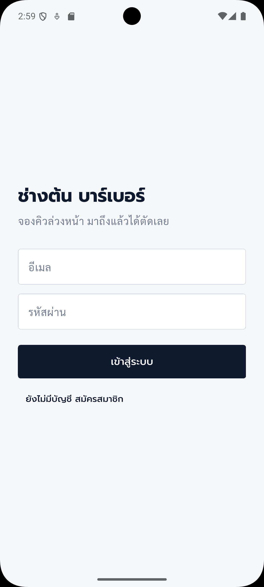
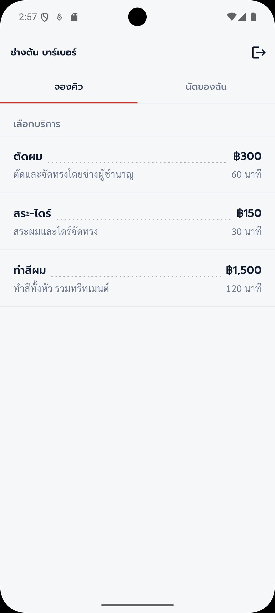
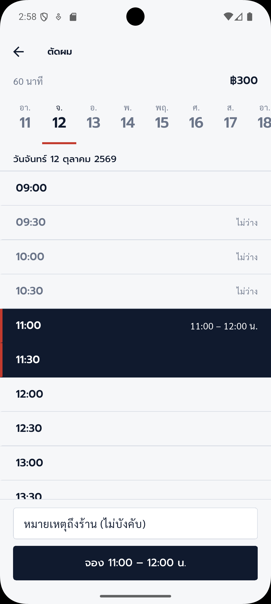
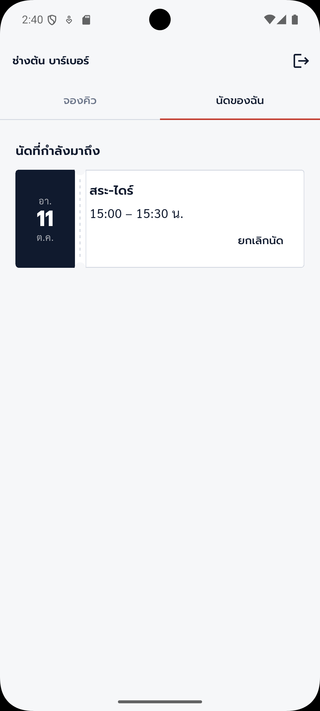

# ระบบจองคิวร้านตัดผม (Flutter)

แอปจองคิวสำหรับร้านตัดผมหรือร้านเสริมสวย เป็นงานตัวอย่างในพอร์ตโฟลิโอ ใช้คู่กับ backend [booking-demo-backend](https://github.com/kitchu-studio/booking-demo-backend)

| เข้าสู่ระบบ | ป้ายราคา | สมุดนัด | นัดของฉัน |
|---|---|---|---|
|  |  |  |  |

## ฟีเจอร์

- สมัครสมาชิก เข้าสู่ระบบ และต่ออายุ token อัตโนมัติ (JWT access + refresh)
- เลือกบริการจากป้ายราคา
- เลือกวันและเวลาจากสมุดนัด แสดงเฉพาะเวลาที่ว่างจริง จองซ้อนกันไม่ได้
- ดูนัดที่กำลังมาถึงและประวัติ ยกเลิกนัดได้

## เทคโนโลยี

Flutter 3.35, Riverpod, Dio, flutter_secure_storage, google_fonts

## วิธีรัน

```bash
flutter pub get
flutter run --dart-define=API_BASE_URL=http://10.0.2.2:8080 --dart-define=SHOP_NAME="ช่างต้น บาร์เบอร์"
```

`10.0.2.2` คือที่อยู่ของเครื่องคอมจาก Android emulator ถ้าใช้มือถือจริงให้ใส่ IP ของคอมแทน

ต้องรัน backend ก่อน ดูวิธีใน README ของ booking-demo-backend

## รับทำแอปแบบนี้

Kitchu Studio รับพัฒนาแอปมือถือและระบบหลังบ้าน (Flutter, Go, AWS)
